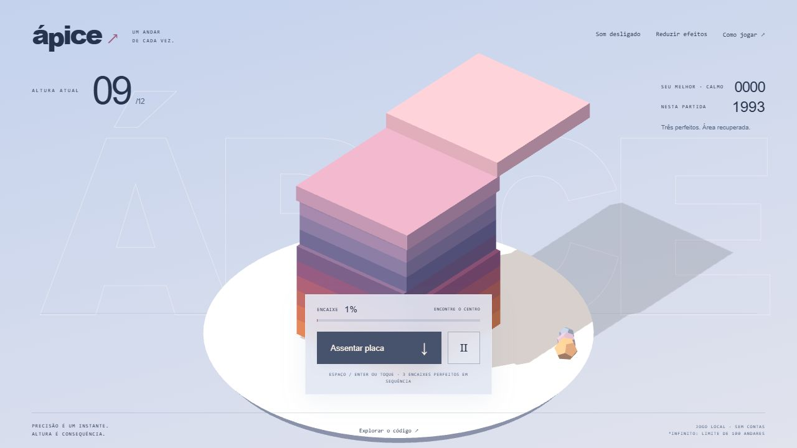

# Ápice ↗

**Um andar de cada vez.** Um jogo 3D de timing e construção: encaixe placas em movimento, deixe o excesso cair e encontre o instante certo para continuar subindo.

**[Jogar no navegador](https://gustapaz.github.io/apice/)**



## Sua torre

- **Expedição:** complete 12 andares para vencer.
- **Infinito:** prossiga até falhar ou concluir o limite técnico explícito de 100 andares.
- **Calmo / Vivo:** dois ritmos, com recordes locais separados por ritmo, considerando pontos de ambos os modos.
- Sem sobreposição suficiente, a placa cai e a rodada termina. A parte apoiada permanece e vira a nova base.
- Encaixes a até 0,12 unidade do centro são perfeitos. Três perfeitos seguidos recuperam 0,18 unidade em cada eixo, até a área inicial. Combos também aumentam os pontos.

Clique/toque em **Assentar placa**, toque na cena ou use **Espaço/Enter** com a área de jogo focada. **P/Escape** na cena ou botão Ⅱ pausa. Menus, ajuda e diálogos também funcionam por teclado. O percentual mostra a sobreposição atual e ajuda a ler a profundidade. O jogo depende de timing; não oferece equivalência completa para leitores de tela.

## Stack

**React 19 + JavaScript + Three.js + Vite.** Geometria, cores, cenário e áudio procedurais originais, sem assets comerciais ou modelos importados. React cuida de menus e HUD; Three.js renderiza a cena fora do ciclo React. Regras ficam em `src/game.js`, sem dependência do renderer.

Requer Node.js 24 LTS e um navegador com **WebGL2**:

```sh
npm ci
npm run dev
npm test
npm run build
npm run preview
```

Abra a URL exibida com `/apice/`. A base de assets está configurada para GitHub Pages. O CI testa, audita dependências, compila e publica somente `dist/`.

## Local e gratuito

Sem backend, API, conta, compras, anúncios ou analytics. O recorde e as preferências de áudio/efeitos são locais e validados, com fallback sem armazenamento. A tentativa em andamento não é salva no reload. O recorde local pode ser alterado pelo dono do dispositivo; não é competição global. Funcionamento offline não é prometido.

Som começa desligado e só é iniciado por gesto. Efeitos reduzidos respeitam a preferência do sistema, removem sobras animadas e simplificam o acompanhamento de câmera. O movimento essencial da placa permanece; escolha Calmo para uma janela de tempo maior.

GitHub Pages está disponível para repositórios públicos no [GitHub Free](https://docs.github.com/en/pages/getting-started-with-github-pages/what-is-github-pages). A demo não exige cartão nem ativação de faturamento. [Validação e limites](docs/validation.md) · [Arte e licenças](docs/assets.md) · [MIT](LICENSE).
